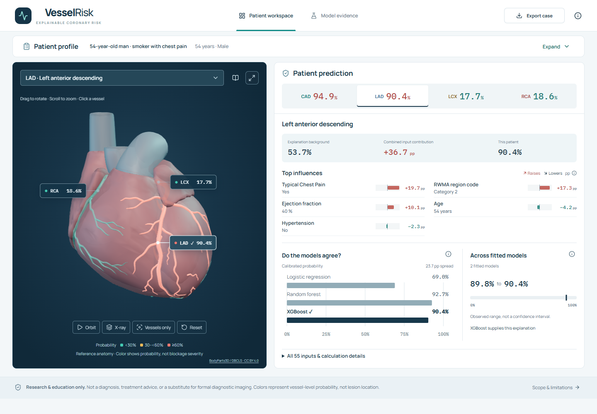

# VesselRisk

**Four coronary predictions. Real 3D anatomy. Inspectable evidence.**

A complete Track A research application: clinical inputs → calibrated CAD/LAD/LCX/RCA estimates → independently selectable coronary artery meshes → exact-probability SHAP explanations. A Model evidence makes the scientific limits as visible as the results.



## Run locally

Use **Python 3.13** and **Node.js 24** (Node 22.13+ is supported by the frontend dependencies). The models and 3D assets are already included. No cloud account, API key or retraining is required.

```powershell
# First run: isolated Python environment, locked npm install, production build
python scripts/start.py --setup

# Subsequent launches
python scripts/start.py
```

Open **http://127.0.0.1:3000**. Use the first case (**54-year-old man, smoker with chest pain**) and click **Predict coronary risk**. Rotate/zoom the heart, select each vessel, inspect its explanation and analytics, then open **Model evidence**. **Ctrl+C** stops both services.

Downloading this repository as a ZIP is sufficient: extract it, open a terminal in the folder containing this README, and run the first-run command above. Setup requires internet access to download Python/npm dependencies. The source package includes the original workbook, trained models, evaluation evidence and 3D assets; it builds the frontend locally, so no prebuilt `.next` directory is needed.

Development: `python scripts/start.py --dev`. Custom ports: `python scripts/start.py --port 3001 --api-port 8001`. Docker alternative: `docker compose up --build` (configuration supplied; Docker is not installed on the build host, so container execution remains unverified).

Manual setup:

```powershell
python -m venv .venv
.venv\Scripts\python -m pip install -r requirements-dev.txt
cd web
npm ci
npm run build
cd ..
python scripts/start.py
```

On Linux/macOS use `.venv/bin/python` instead. If serving separate processes, run `python -m uvicorn api.main:app --host 127.0.0.1 --port 8000` from the repository root and `npm run start` from `web`. The frontend proxies its model API at request time; set `API_URL` when using a different backend host/port.

## What judges can inspect

- **Patient workspace:** all 55 source-compatible clinical inputs, grouped tabs, JSON import/export, held-out demonstration cases, four real estimates, model comparison, representation warnings and local explanations.
- **Anatomical viewer:** 63 real BodyParts3D structures, 37,444 triangles, about 1 MB; independently colored LAD/LCX/RCA, rotation, zoom, pan, vessel selection, orbit, X-ray, isolation and expansion. No invented lesion locations.
- **Model evidence:** nested OOF ROC/PR/calibration curves, confusion matrices, complete metrics, candidate comparisons, calibration sensitivity, fold dispersion, conditional intervals, global SHAP and rank stability, subgroup checks, ablations, failure cases, schema/provenance and artifact hashes.
- **Scientific traceability:** source workbook hash, model hashes, fitted fold artifacts, split indices and all 303 repeat-averaged OOF predictions per target are included.

## Measured results

Repeated nested stratified CV: **5 outer folds × 2 repeats**, with **3-fold inner selection** of logistic regression, random forest and XGBoost. Sigmoid calibration is fitted entirely inside training partitions. Each patient contributes one probability after averaging its two held-out predictions. These are internal estimates, **not external clinical validation**.

| Target | ROC-AUC [95% conditional CI] | Accuracy | Precision | Recall | F1 | PR-AUC (AP) | Brier ↓ |
|---|---:|---:|---:|---:|---:|---:|---:|
| CAD | **0.925** [0.891, 0.954] | 0.868 | 0.896 | 0.921 | 0.909 | 0.967 | 0.094 |
| LAD | **0.839** [0.791, 0.886] | 0.789 | 0.793 | 0.864 | 0.827 | 0.868 | 0.157 |
| LCX | **0.728** [0.670, 0.786] | 0.673 | 0.625 | 0.420 | 0.503 | 0.575 | 0.206 |
| RCA | **0.732** [0.672, 0.790] | 0.660 | 0.570 | 0.395 | 0.466 | 0.577 | 0.201 |

Threshold **0.50** is a research convention, not a clinical operating point. LCX/RCA have low recall at this threshold, and their weaker results remain visible. Bootstrap intervals use 1,000 patient-stratified resamples conditional on fitted folds; they omit retraining/selection uncertainty. Fold SD is descriptive because folds overlap. Headline scores evaluate a nested selection policy, distinct from the deployed family chosen on the full cohort.

The supplied workbook has **one contradictory record**: one-based row 94 is Cath Normal but LAD Stenotic. The original labels are retained independently and the discrepancy is reported. The empty second worksheet is ignored. `LAD`, `LCX`, `RCA` and `Cath` are forbidden inputs to **every** model and baseline. A programmatic guard rejects them during fit and inference.

A final bounded vessel experiment retained the original models: expanded ExtraTrees/RBF-SVM search did not pass the predeclared AUC/Brier gate. Training-only nested F1 cutoffs increased **LCX recall/F1 to .840/.641** and **RCA to .868/.631**, with precision .518/.495 and accuracy .630/.617. False positives rose 30→93 / 34→101. These research operating points appear beside the fixed 0.50 results in Model evidence; probabilities, AUC/Brier and workspace convention are unchanged. [Full paired results and method](docs/VESSEL_REFINEMENT.md) describe the development limitations.

## Reproduce the science

Run from the repository root with the pinned Python environment:

```powershell
python -m ml.train       # Refit and re-evaluate all four targets from the original XLSX
python -m ml.refine_vessels # One bounded vessel/threshold experiment, paired to the new frozen artifacts
python -m ml.evaluate    # Verify frozen OOF metrics and source/model hashes; export metrics CSV
python -m ml.reliability # Audit local SHAP stability and calibration of frozen predictions; no fitting
python -m pytest        # Scientific validity, leakage, prediction and API checks
```

Training is deterministic under the pinned environment and seed 2026. It uses six predeclared candidate configurations and selection score `inner ROC-AUC - 0.25 × Brier`. It includes raw/sigmoid/isotonic sensitivity analysis and fixed-logistic feature-group ablations. Checkpoints resume only when data, target, seed, schema, repeats, training-source hashes, Python and dependency versions match. Legacy or mismatched checkpoints restart automatically; writes use temporary files followed by replacement. Final submission excludes these intermediates. Restart the API after retraining. API startup checks `integrity.json` against all model bundles, OOD, registry, evidence and schema before deserializing any estimator. Training writes this manifest automatically; `python -m ml.integrity` is an explicit packaging operation for already-trusted files, not a repair for unexplained mismatches.

The additional [reliability audit](docs/RELIABILITY_AUDIT.md) preserves the frozen model weights and headline evidence. It adds calibration group counts, descriptive Wilson intervals, Brier intervals and a training-only prevalence baseline, separate-repeat metrics, and local SHAP seed/computation/background sensitivity on four predefined held-out profiles. Model evidence exposes the details on demand. Audit results are loaded only when source and artifact fingerprints match. CI runs desktop Chromium integration tests as well as scientific tests and frontend checks.

```powershell
cd web
npm run typecheck
npm run lint
npm run build
npx playwright install chromium
npx playwright test
```

Start both services before local browser tests. To test a different frontend port set `DEMO_URL`. CI starts its own frontend and backend. Desktop Chromium tests exercise real predictions, 3D selection/X-ray, synchronized target routing, evidence, calibration counts, input origins, edits and exports using software-rendered WebGL. Screenshots are generated in `demo/screenshots/`. The project targets desktop browsers only.

## Model API

Interactive typed schema: **http://127.0.0.1:8000/docs**.

| Endpoint | Purpose |
|---|---|
| `GET /health` | Ready status and verified artifact integrity |
| `GET /schema` | Full feature dictionary and input categories |
| `GET /cases` | Original cohort features and recorded outcomes for four illustrative held-out cases |
| `POST /predict` or `/explain` | Complete 55-feature input → four calibrated estimates, SHAP, disagreement, resampling ranges, OOD and warnings |
| `GET /evidence` | Full measured evaluation artifact |
| `GET /model-info` | Exact family/parameters, version, hashes and libraries |
| `GET /report` | Six-page technical PDF |

Example without a hand-written clinical fixture:

```python
import requests
case = requests.get('http://127.0.0.1:8000/cases').json()['cases'][2]
result = requests.post('http://127.0.0.1:8000/predict', json={
    'features': case['features'], 'case_id': case['id']
}).json()
print({target: item['probability'] for target, item in result['targets'].items()})
```

The service rejects missing, unknown, target-bearing, nonfinite and unsupported inputs. Predictions and explanations use the same selected model. Base probability plus all SHAP contributions reconstructs the probability, not a raw margin. Attribution is approximate and noncausal.

Before unpickling, startup checks scikit-learn against the artifact registry. An incompatible installation exits with the required/installed versions and `python scripts/start.py --setup`, instead of reaching an incompatible estimator's prediction traceback. For manual tests, use the pinned environment (on Windows: `.venv\Scripts\python -m pytest`).

Held-out demo rows are excluded from displayed models and explanation backgrounds. Patient edits retain the excluded-row models and become **held-out sensitivity**; recorded outcomes are hidden. New profiles use full-cohort fitted models. UI defaults are cohort medians/modes and must be reviewed. The input summary counts cohort-record, cohort-default, user-entered, imported and calculated values; field hover identifies the source, and case exports include `input_sources`. These are application provenance labels, not verification that a value was clinically measured. Refitted-model ranges and OOD distance are descriptive heuristics, **not clinical confidence intervals**.

## Submission materials

- [Final strict rubric audit](docs/FINAL_AUDIT.md) and [completed investigation / before-after results](docs/FINAL_AUDIT_RESULTS.md): the additional elastic-net, HistGradientBoosting and CatBoost batch found no material expanded-policy gain; all deployed model artifacts remain unchanged. [Literature comparison](docs/MODEL_OPTIMIZATION_RESEARCH.md) explains why the vessel AUCs are not a proven ceiling. Audit-only code/results are isolated in `experiments/final_audit/`; verify without CatBoost using `python -m experiments.final_audit.verify`.
- [Devpost copy](docs/DEVPOST_COPY.md) and timed demo opening are ready for submitter review. The required final YouTube video and actual entry/repository links remain outstanding.

- [Offline review hub](review/index.html): eleven real product screenshots, complete model metrics/fold dispersion, methodology, 3D provenance and [completion summary](review/COMPLETION_SUMMARY.md). Build a verified repo ZIP with `python scripts/package_review.py`; recapture screenshots from the running app with `node scripts/capture_review.mjs`.
- [Six-page technical report](report/VesselRisk-Track-A.pdf), generated from real evidence and browser screenshots with `python scripts/build_report.py`.
- [Second-by-second 7:00 recording script](demo/DEMO_SCRIPT.md): 37 scenes from local startup through example prediction, manual custom inputs, 3D interaction and every Model evidence section.
- [English narration](demo/DEMO_NARRATION_EN.md) and [fixed timing source](demo/DEMO_TIMELINE.json) for later TTS/subtitle production. Recording fixtures and [desktop rehearsal results](demo/DEMO_REHEARSAL.json) are included; these synthetic profiles test software behavior, not clinical accuracy.
- [Data/model card and limitations](docs/DATA_MODEL_CARD.md).
- [Architecture and Mermaid source](docs/ARCHITECTURE.md).
- [Prior-winner research and primary references](docs/RESEARCH.md).
- [Licenses and asset attribution](ATTRIBUTIONS.md).
- [Final submission checklist](docs/SUBMISSION_CHECKLIST.md).
- [Verification record](docs/VERIFICATION.md).
- [Public submission contents](docs/SUBMISSION_CONTENTS.md): retained runtime files and excluded local development artifacts. Run `python scripts/submission_files.py --tracked` before publishing; generated review ZIPs belong in release attachments, rather than inside the source repository.

The final 3–10 minute YouTube recording/upload and competition submission require the submitter's account. No video link or remote deployment is fabricated. Local software is fully integrated and does not depend on cloud credentials.

## Safety and use limits

**Research, education and exploratory decision support only.** Not a diagnosis, treatment recommendation, validated population screening tool or substitute for formal diagnostic imaging. Single 303-patient referral cohort; no external validation. Generic adult male anatomy; no patient-specific geometry, stenosis severity or lesion coordinates. RWMA remains a categorical clinical feature. Independent CAD/vessel classifiers may disagree; those inconsistencies are exposed.

Patient inputs remain local to the running app/API, with a bounded in-memory prediction cache cleared on API restart. No external AI inference service, account system or patient database is used. Do not load untrusted joblib artifacts. See the model card for all failure modes and uncertainty limitations.

**AI disclosure:** OpenAI Codex assisted research, implementation, debugging, validation, UI and report drafting. No generative model predicts disease or gives medical advice. Results are computed from the supplied workbook. The submitter should review the implementation and be able to explain it.

Original application code: MIT. Source dataset and BodyParts3D anatomy: CC BY 4.0; fonts: OFL. Full third-party terms and exact modifications are in [ATTRIBUTIONS.md](ATTRIBUTIONS.md).
