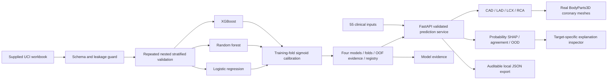

# System architecture

`ml/schema.py` owns source feature meaning and fail-closed leakage validation. `ml/modeling.py` owns fold-local pipelines, search, calibration and calibrated-probability SHAP. `ml/train.py` exports reproducible scientific evidence; checkpoint files are local intermediates and excluded from submission. `api/service.py` loads verified model artifacts and preserves held-out demo separation. `api/main.py` exposes the service through validated requests and documented endpoints.

Next.js serves the UI and proxies `/api/*` to FastAPI, avoiding browser CORS configuration. The heart renderer loads local geometry and independently colors/selects coronary branches. Projected labels follow actual artery surface vertices through rotation, avoid overlap, and display each vessel probability. A faint silhouette exposes the selected artery through occluding heart-wall geometry. The patient form exposes all 55 columns; the initial view is a compact key-input subset with tabs for the rest. Edited inputs immediately mark existing results as stale; probability, heart and explanations update together only after a successful prediction.

Patient workspace shows patient-specific contributions, probability accounting, candidate disagreement and fitted-model ranges. Model evidence has independent target navigation and reads the same frozen evidence JSON used to generate the technical report; editing patient inputs does not change its cohort results. Model curves render without data interpolation animation, so a target switch cannot transiently display a scientifically misleading curve. Displayed performance is internal nested OOF evidence, distinct from deployed full-cohort model identity. Full SHA-256 values and feature dictionaries can be inspected/exported.

Anatomy source derivative is pinned to `ashemag/human-atlas` commit `1c38bf35c254a891200d3cedecfd57abebe83d8d`, itself from BodyParts3D 4.0. Exact mesh IDs, source names, changes and binary hash are in `web/public/anatomy/manifest.json`. Geometry remains anatomically sourced; no lesion position is fabricated.

Target identity colors match the report: CAD teal (#168e8b), LAD blue (#4f8bba), LCX gold (#c59841), RCA coral (#cf7874). `web/lib/target-colors.ts` defines chart accents and darker text/tints. Fixed evidence curves, global SHAP bars and target labels use these identities. Patient probabilities and anatomy retain their probability-band colors; signed patient contributions retain raise/lower colors. Identity colors do not encode likelihood or severity.
